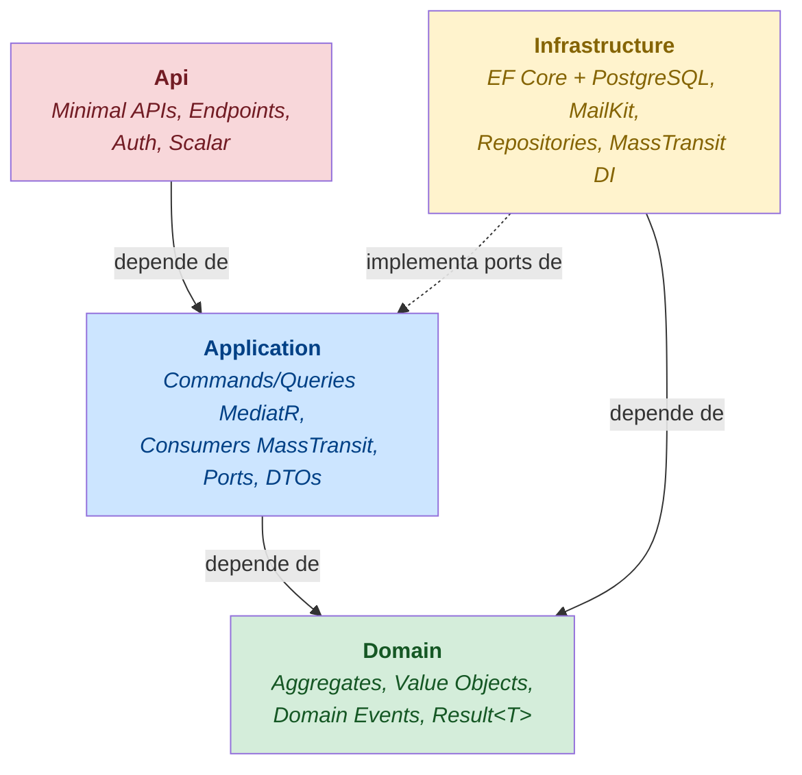
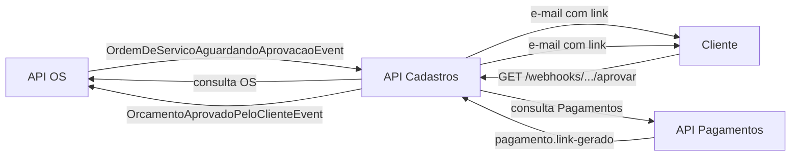

# Arquitetura

## Visão geral

A API de Cadastros é o microsserviço responsável por:

- CRUD de **Clientes** (com seus **Veículos**), **Produtos** e **Serviços**
- **Notificações por e-mail** ao cliente — orçamento para aprovação e link de pagamento
- **Webhook HMAC** para receber a decisão do cliente (aprovar/rejeitar orçamento)
- **Publicação de eventos** cross-service quando o cliente aprova ou rejeita

Faz parte do ecossistema Mecânica Hermes ao lado de `mecanica-hermes-api-ordem-servico` (OS) e `mecanica-hermes-api-pagamentos` (Pagamentos). Para o fluxo completo, consulte também o [`messaging.md`](./messaging.md).

## Camadas (Clean Architecture)

A **regra de ouro**: dependências sempre apontam para dentro (em direção ao Domain). Infrastructure e Api não são referenciadas pelo Application nem pelo Domain.

## Padrões aplicados

| Padrão | Implementação | Por quê |
| --- | --- | --- |
| **CQRS via MediatR** | Commands/Queries em `Application`; handlers separados por responsabilidade | Separação de leitura e escrita sem overhead de event sourcing |
| **Result&lt;T&gt;** | `Result` e `Result<T>` carregam `HttpStatusCode` + `Errors[]`; sem lançar exceções no fluxo de negócio | Erros de domínio são dados, não exceções |
| **Value Objects** | `EmailVo`, `NomeProprioVo`, `TelefoneVo`, `IdentificacaoFiscalVo` (CPF/CNPJ), `PlacaVo`, `DescricaoProdutoVo`, `QuantidadeProdutoVo`, `ValorProdutoVo` | Invariantes garantidas no construtor, sem validação espalhada |
| **MapperExtensions estáticos** | `ToCommand()`, `ToResponse()`, `ToEntity()`, `ToDomain()` em classes `*Mappings` | Zero reflexão em runtime; compilação valida os mapeamentos ([ADR-003](./adrs.md#adr-003)) |
| **Domain Events via MediatR** | `IDomainEventDispatcher` despacha após `CommitAsync` via `IPublisher`; **sem Outbox** | Cadastros não tem writes críticos pós-evento — best-effort aceitável ([ADR-002](./adrs.md#adr-002)) |
| **Minimal APIs** | Endpoints em classes estáticas com `MapGet/Post/Put/Delete` | Baixo overhead, sem reflection-based routing |

## Integrações externas

| Direção | Client / Porta | Destino | Propósito |
| --- | --- | --- | --- |
| Saída | `OrdemServicoApiClient` (`IOrdemServicoApiClient`) | API de OS — `GET /api/ordens-de-servico/{id}` | Obter dados da OS para montar e-mail de orçamento |
| Saída | `PagamentoApiClient` (`IPagamentoApiClient`) | API de Pagamentos — `GET /api/pagamentos/{id}` | Obter link e valor do pagamento para montar e-mail |
| Entrada M2M | `GET /api/clientes/{id}` com `servico-scope` | API de Pagamentos como cliente | Pagamentos consulta dados do cliente para gerar o pagamento ([ADR-006](./adrs.md#adr-006)) |

Os HTTP clients de saída usam **Polly** via `AddStandardResilienceHandler` (retry + circuit breaker + timeout).

## Fluxo de notificação

## ADRs relevantes

Consulte o arquivo completo em [`adrs.md`](./adrs.md). Resumo:

| ADR | Decisão |
| --- | --- |
| ADR-001 | Sem SAGA — fluxo linear, MediatR direto |
| ADR-002 | Sem Outbox — best-effort aceito neste serviço |
| ADR-003 | MapperExtensions em vez de AutoMapper |
| ADR-004 | `[EntityName]` canônico para roteamento cross-service |
| ADR-005 | Webhook HMAC-SHA256 para aprovação assíncrona de orçamento |
| ADR-006 | Escopo `servico-scope` para acesso M2M da API de Pagamentos |
