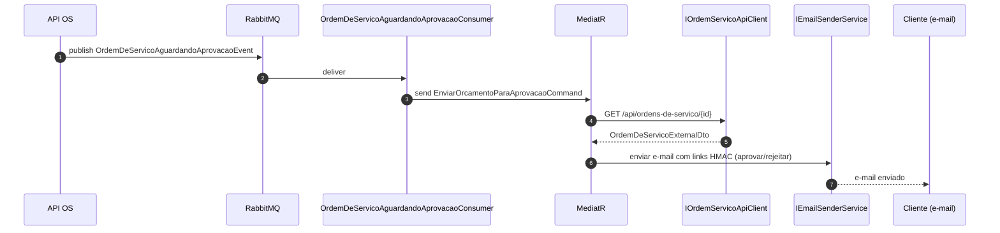
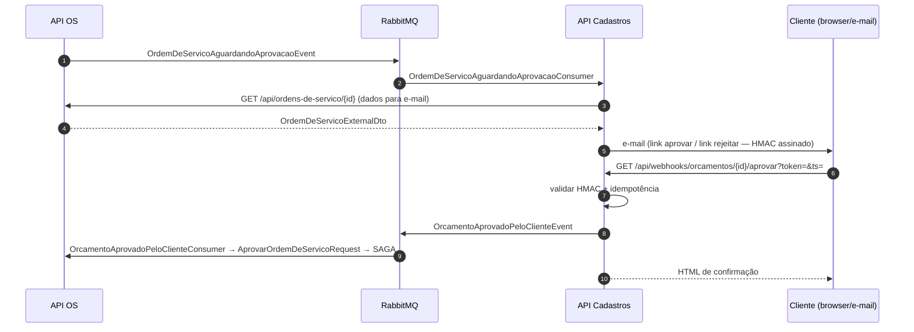

# Mensageria

## Visão geral

A API de Cadastros usa **MassTransit sem SAGA**. O bus é usado exclusivamente para:

1. **Consumir** eventos publicados por OS e Pagamentos e disparar commands via MediatR
2. **Publicar** eventos de decisão do cliente (aprovação/rejeição de orçamento) para que a OS reaja

Não há orquestração interna — o fluxo é linear: evento recebido → command MediatR → handler → resposta.

> Para o contexto completo do ecossistema, consulte também o [`messaging.md`](../../mecanica-hermes-api-ordem-servico/docs/messaging.md) da API de OS e o da API de Pagamentos.

## Roteamento

- **Formatter:** `KebabCaseEndpointNameFormatter("mecanica-hermes-cadastros", includeNamespace: false)`
- **Prefixo de filas:** `mecanica-hermes-cadastros.` (configurável via `MASSTRANSIT__QUEUE_NAME_PREFIX`)
- **EntityName canônico:** todos os eventos cross-service usam `[EntityName("kebab-case")]` — o roteamento MassTransit depende do `EntityName`, não do namespace .NET ([ADR-004](./adrs.md#adr-004))

## Eventos consumidos

| EntityName | Publicador | Consumer | Ação |
| --- | --- | --- | --- |
| `ordem-de-servico.aguardando-aprovacao.v1` | API de OS | `OrdemDeServicoAguardandoAprovacaoConsumer` | Dispara `EnviarOrcamentoParaAprovacaoCommand` — busca dados da OS e envia e-mail com links de aprovação/rejeição |
| `pagamento.link-gerado.v1` | API de Pagamentos | `LinkPagamentoGeradoConsumer` | Dispara `EnviarLinkPagamentoCommand` — busca dados do pagamento e envia e-mail com o link ao cliente |

### Detalhe do fluxo — orçamento

### Detalhe do fluxo — link de pagamento

O `LinkPagamentoGeradoConsumer` segue o mesmo padrão, consultando `IPagamentoApiClient` em vez de `IOrdemServicoApiClient`.

## Eventos publicados

| EntityName | Evento | Gatilho | Payload |
| --- | --- | --- | --- |
| `orcamento.aprovado-pelo-cliente.v1` | `OrcamentoAprovadoPeloClienteEvent` | `GET /api/webhooks/orcamentos/{id}/aprovar?token=&ts=` | `OrdemDeServicoId`, `AprovadoEm` |
| `orcamento.rejeitado-pelo-cliente.v1` | `OrcamentoRejeitadoPeloClienteEvent` | `GET /api/webhooks/orcamentos/{id}/rejeitar?token=&ts=&motivo=` | `OrdemDeServicoId`, `RejeitadoEm`, `Motivo?` |

A publicação usa `IPublishEndpoint.Publish(new OrcamentoAprovadoPeloClienteEvent(...))` diretamente no handler do endpoint de webhook, **após** a validação HMAC e o registro de idempotência na tabela `webhook_events`.

## Webhook HMAC

Os links enviados ao cliente no e-mail de orçamento são **URLs assinadas com HMAC-SHA256** para garantir autenticidade e evitar falsificação.

### Como funciona

1. `INotificacoesUrlBuilder` constrói a URL com parâmetros `token` e `ts`
2. `IWebhookTokenSigner.Sign(ordemDeServicoId, ação)` calcula `HMAC-SHA256(segredo, "{id}:{ação}:{ts}")`
3. O cliente clica no link; o endpoint de webhook chama `IWebhookTokenSigner.Validate(...)`
4. Validação rejeita se:
   - Assinatura não confere
   - `ts` está fora do intervalo de ±30 dias (janela configurável)
5. Idempotência via tabela `webhook_events` (constraint única por `OrdemDeServicoId + Ação`)

### Variáveis relacionadas

| Variável | Descrição |
| --- | --- |
| `WEBHOOK__SIGNING_SECRET` | Segredo HMAC (obrigatório; mínimo 32 bytes recomendado) |
| `APP__BASE_URL` | Base URL desta API — usada para construir os links nos e-mails |

## Fluxo end-to-end — aprovação de orçamento

